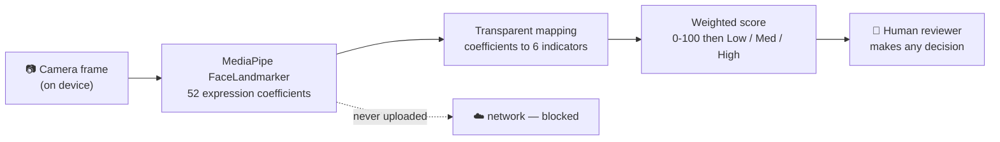
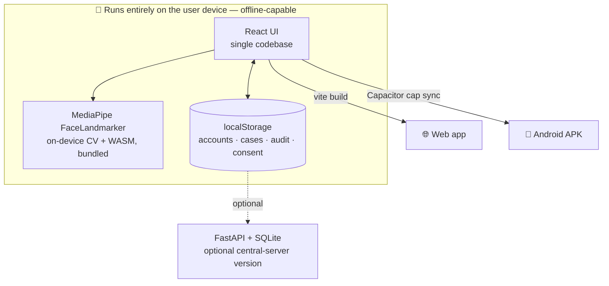

<div align="center">

# 🛡️ Safe Path Mauritius

### An ethical, privacy-first AI that helps communities offer support *earlier* — without surveillance, labels, or judgement.

**Web + Android · Runs fully on-device · No backend required**

*Built for the **Game of Code 2026** hackathon — the "Towards Recovery" challenge.*

<sub>Latest build: <b>Update 5.4</b> · fully on-device · see the <a href="SafePath-CHANGELOG.md">changelog</a></sub>

</div>

> **Not a diagnostic tool. Does not detect or confirm substance use.**
> Safe Path reads *emotional and behavioural expression signals* from a short, **on-device**
> facial check-in and routes them to a **human reviewer**. The AI never decides anything — it only
> prepares a signal for a person to act on, kindly.

---

## 📑 Table of contents

- [The problem](#-the-problem)
- [Our solution](#-our-solution)
- [What makes it original](#-what-makes-it-original)
- [The user journey](#-the-user-journey)
- [Features](#-features)
- [How the AI works](#-how-the-ai-works)
- [Architecture](#-architecture)
- [Privacy & ethics](#-privacy--ethics)
- [Engineering highlights](#-engineering-highlights)
- [Tech stack](#-tech-stack)
- [Getting started](#-getting-started)
- [Project structure](#-project-structure)
- [How we meet the judging criteria](#-how-we-meet-the-judging-criteria)
- [Limitations (honest)](#-limitations-honest)
- [Roadmap](#-roadmap)
- [Documentation](#-documentation)
- [Disclaimer & acknowledgements](#-disclaimer--acknowledgements)

---

## 🌍 The problem

Substance misuse rarely begins with a crisis — it begins with **quiet, early signals**: rising
stress, withdrawal, low mood, disrupted routines. By the time those signals are obvious, the
easiest moment to help has often passed. In Mauritius, where specialist mental-health and
addiction resources are limited, **earlier and kinder outreach** can change outcomes.

But "AI for risk detection" is also where these projects usually go wrong. Most become a form of
**surveillance**: scoring people without consent, profiling faces, sending data to a server, and
making high-stakes decisions automatically. For a challenge about *recovery and safer
communities*, that is exactly the wrong instinct — and it is precisely the failure mode an ethics
panel will probe first.

**The hard question we set out to answer:**
*Can AI surface early, supportive signals **without** becoming a surveillance machine?*

Our entire design is an answer to that question.

## 💡 Our solution

Safe Path Mauritius is a **consent-first, human-in-the-loop** application where the person is the
**owner and beneficiary** of their data — not a subject being scored.

1. **A person opts in** and completes a short, on-device facial **check-in**.
2. The app estimates six **emotional/behavioural expression signals** — entirely on the device.
3. It explains the result in plain language, shows the **trend over time**, and — if concern is
   high — surfaces **real crisis helplines**.
4. If the person chooses, the check-in becomes a **case for a trained human reviewer**, who is the
   only one who ever decides whether and how to offer support.

It runs as a **web app** and ships as a **native Android app** from a single codebase — and it
works **fully offline, with no backend to deploy**.

## ✨ What makes it original

Most teams build a "risk classifier" that flags people to authorities. We deliberately inverted
every part of that idea:

| The common approach | Safe Path's approach |
| --- | --- |
| A cloud model scores you | An **on-device** model — your face and video never leave the phone |
| A black-box risk number | **Glass-box**: every signal shows the exact facial cues behind it |
| The AI makes the decision | **Human-in-the-loop is mandatory** — the AI only *prepares* a signal |
| "Detects drug use" (pseudoscience) | Detects **expression**, and explicitly *not* substance use |
| Privacy as a paragraph in the pitch | **Privacy as mechanism** — no upload, no server, hashed local accounts |
| A one-shot snapshot | A **trend over time** — which is what "early indicators" actually means |

The result: the privacy promise is something we can **demonstrate**, not merely claim — and the
ethics are part of the architecture, not a disclaimer bolted on at the end.

## 🧭 The user journey

**Citizen (anonymous, no account, fully offline):**

1. **Landing** → reads the mission and the ethics commitments.
2. **Consent** → gives explicit, recorded, revocable consent. Nothing runs before this.
3. **Check-in** → starts the camera; a live box tracks the face with a real-time emotion label; a
   3-second scan reads six indicators **on the device**.
4. **Results** → sees an explainable 0–100 concern score, the facial cues behind each signal, the
   personal **trend over time**, and — for high concern — a **crisis card** with tap-to-call
   helplines and support resources.
5. **Send to reviewer** (optional) → the check-in becomes an **anonymous case** (e.g. `Check-in
   #6110`) in the staff queue.

**Staff (trained reviewer / admin, account required):**

6. **Sign in / register** → role-based access with hashed passwords.
7. **Reviewer dashboard** → reviews flagged cases, adds notes, and chooses Approve / Hold /
   Dismiss.
8. **Referral** → routes a case to a support partner — never automatically.
9. **Admin & oversight** → inspects consent records and the full **audit trail**.

## 🧩 Features

### For the person — no account, fully offline

- **Consent first.** Explicit, **recorded**, and **revocable**. Nothing analyses anything before
  the person agrees.
- **Live on-device check-in.** A green box tracks the face in real time with a live emotion label;
  a short scan reads six indicators: *stress, sadness, agitation, fatigue, withdrawal, avoidant
  gaze*.
- **Explainable results.** A 0–100 concern score with the **specific facial cues** behind each
  signal — nothing is a black box.
- **Trend over time.** A private, on-device history with a sparkline and a plain-language read of
  whether signals are *rising / easing / steady*, plus per-signal drift.
- **Crisis & support pathway.** High concern surfaces a supportive card with **tap-to-call
  Mauritius helplines** (Befrienders 800 9393, Police 999, Ambulance/SAMU 114) and treatment
  resources.

<!-- Screenshot placeholder — citizen flow (landing / check-in / results). -->

### For trained staff — account + role-based access

- **Sign in / register.** Reviewer or admin accounts, passwords **hashed** with Web Crypto
  (PBKDF2) — never stored in plain text.
- **Reviewer dashboard.** Flagged cases (each anonymous check-in carries a short reference like
  `Check-in #6110`, with **no personal data**), reviewer notes, and Approve / Hold / Dismiss.
- **Referral workflow.** Route a case to a support partner — a deliberate, human action, **never
  automatic**.
- **Admin & oversight.** Consent records and a complete **audit trail** of every action — proof
  that nothing is hidden or automated.

<!-- Screenshot placeholder — staff flow (reviewer / referral / admin). -->

## 🧠 How the AI works

The facial analysis runs **entirely in the browser / WebView** using Google's **MediaPipe
FaceLandmarker** — a real, production computer-vision model. It is a transparent, three-stage,
**glass-box** pipeline:



1. **Sense.** FaceLandmarker outputs 52 standard facial-expression coefficients ("blendshapes")
   per frame, averaged across the scan. It runs on the CPU delegate, which produces the expression
   data reliably across devices.
2. **Map.** A small, hand-written, fully documented mapping turns those coefficients into the six
   review indicators. Every signal records the exact facial cues that produced it.
3. **Score.** A transparent weight table turns the indicators into a 0–100 score and a concern
   band.

**The transparent indicator mapping** (full table in the model card):

| Indicator | Example facial cues used |
| --- | --- |
| Stress | brow lowering, eye squint, lip pressing |
| Sadness / low mood | mouth frown, inner-brow raise |
| Agitation | jaw opening, brow lowering, mouth stretch |
| Fatigue | eye closing (droop), chin tension |
| Withdrawal | downward gaze, closed mouth |
| Avoidant gaze | gaze aversion (looking away) |

It estimates **expression**, never a substance-use verdict — and every result is routed to a
human. Honest limitations and bias considerations are documented openly in the model card.

## 🏗️ Architecture

**One React codebase → two products, zero backend required.**



- **The frontend is the whole app.** All logic, the on-device data layer, and the AI pipeline live
  in React. There is no required server.
- **Mobile is the same files.** Capacitor wraps the web build into a native Android APK, with the
  AI model bundled so the camera analysis works offline.
- **The backend is optional.** A FastAPI + SQLite server remains in the project for teams that want
  a shared central database, but the app does not depend on it. The earlier "start the backend"
  steps no longer apply to normal use.

### Data model (on-device)

| Store | Holds | Notes |
| --- | --- | --- |
| Accounts | email, role, salted **hash** | Web Crypto PBKDF2; never plain text |
| Cases | anonymous reference, concern band, indicators, status, notes, referral | No personal data |
| Audit log | every consent event and review action, timestamped | Oversight / accountability |
| Consent | timestamp + policy version | Revocable; no personal data |
| Check-in history | recent scores + per-signal intensities | Powers the trend view |

## 🔐 Privacy & ethics

This is the part we are proudest of — ethics designed **into the architecture**, not added as a
disclaimer:

| Commitment | How it is enforced |
| --- | --- |
| **On-device by default** | The whole app runs with no server. Camera frames are processed locally and discarded. |
| **No upload, ever** | The face and video never leave the device — only aggregate signals exist, only for the session. |
| **No biometric identity** | No face template is stored and no identity recognition is performed. |
| **Data minimization** | Stored on-device only: consent (timestamp + version), an audit log, and hashed accounts. No names, faces, or video. |
| **Human-in-the-loop** | No automated action, ever. A trained person makes every decision. |
| **Transparency** | Every signal shows its facial cues; the full model is documented. |
| **Honest framing** | Non-diagnostic throughout; bias and failure modes are stated openly. |

**Explicitly out of scope and prohibited:** medical or psychiatric diagnosis, law enforcement,
surveillance, insurance, employment, or any covert or non-consensual scanning. The full statement
lives in the ethics document and the in-app **Ethics & privacy** page.

## ⚙️ Engineering highlights

A few decisions we think reflect real execution quality:

- **Genuinely on-device CV.** Not a mock — MediaPipe FaceLandmarker runs in the WebView, with the
  WASM runtime and model bundled for offline use, and a GPU→CPU fallback for device compatibility.
- **Reliable on a real phone.** The camera preview is drawn into a canvas (the camera frame *and*
  the tracking box on one layer) to avoid the Android WebView hardware-surface issue that hides
  overlays; detection is time-throttled and crash-proofed so it never stalls.
- **Closed the loop.** A check-in can become a real case in the reviewer queue, with a referral and
  an audit entry — the citizen side and the staff side are one connected system.
- **Security basics done right.** Passwords are salted and hashed with PBKDF2 via Web Crypto; the
  app stores no plaintext credentials and no personal data.
- **One codebase, two targets.** The exact same React source powers the web app and the Android
  APK; there is no divergent mobile codebase to maintain.

## 🛠️ Tech stack

| Layer | Technology |
| --- | --- |
| UI | **React 18**, **React Router 6**, **Vite 5** |
| On-device AI | **`@mediapipe/tasks-vision`** (FaceLandmarker), bundled WASM + model for offline use |
| Mobile | **Capacitor 6** → native Android APK |
| Data & security | **On-device** storage + **Web Crypto** (PBKDF2 password hashing) |
| Design | Hand-built, mobile-first design system — calm, accessible, no UI framework |
| Optional backend | **FastAPI** + **SQLite** — not required |

## 🚀 Getting started

### Prerequisites
- **Node.js** (LTS) — for the web app.
- **Android Studio** — only if you want to build or run the APK yourself (it bundles the JDK and
  Android SDK).

### Run the web app
```bash
cd frontend
npm install
npm run dev          # http://localhost:5173
```

### Try the Android app
A ready-to-install debug APK is included. Copy it to an Android phone and tap to install
("install from unknown sources"). To rebuild after changes:
```bash
cd frontend
npm install
npm run cap:sync     # builds the web app and copies it into the Android project
# then open the android folder in Android Studio and press Run / Build APK
```
Full, beginner-friendly steps are in the build guide.

> The app works **fully offline** — there is no backend to start. (The optional server version can
> still be run with `uvicorn backend.app:app --port 8000`.)

### 90-second demo script
1. **Home → Consent** (tick + agree) → **Check-in** → **Start camera** → **Analyze expression**.
2. See the **score, the facial cues, the trend**, and — if high — the **crisis card**.
3. **Send to reviewer** → it becomes a case.
4. **Staff log in → Create account** (try a *reviewer* and an *admin*) → see the **case, referral,
   and audit trail**.

## 📂 Project structure

```
frontend/                       The entire app (web + Android source)
├── src/
│   ├── components/             All screens (Landing, Consent, Analysis, Results, …)
│   ├── faceAnalysis.js         On-device MediaPipe pipeline (glass-box mapping)
│   ├── api.js                  On-device data layer (accounts, cases, audit, scoring)
│   ├── history.js              On-device check-in trend history
│   ├── data/resources.js       Crisis & support resources (editable)
│   └── styles.css              Design system
├── public/mediapipe/          Bundled AI model + WASM (offline)
├── android/                   Capacitor native Android project
└── capacitor.config.json
backend/                        OPTIONAL FastAPI + SQLite server (not required)
docs/
├── MODEL_CARD.md               Model card (full signal mapping, limits, bias)
└── ETHICS.md                   Ethics statement
README.md                       You are here
BUILD_GUIDE.md                  Beginner-friendly build instructions
SafePath-CHANGELOG.md           Version history
```

## 🏆 How we meet the judging criteria

| Criterion | How Safe Path delivers |
| --- | --- |
| **Originality** | The inverted, anti-surveillance design: on-device, glass-box, human-in-the-loop, user-as-owner, with trend-over-time — not another cloud risk classifier. |
| **Execution** | A real, working on-device CV pipeline, a polished mobile-first UI, real hashed accounts, a closed check-in → case → referral loop, and a native Android APK — all from one codebase, fully offline. |
| **Documentation** | This README plus a model card, an ethics statement, a build guide, and a changelog — including the full signal mapping and honest limitations. |
| **Safer communities** | Consent-first early support, real Mauritius crisis pathways, non-punitive referral, and accountable oversight via an audit trail — designed to help *before* a crisis, safely. |

## ⚠️ Limitations (honest)

- Facial-expression signals are **heuristic proxies**, not validated clinical measures; a single
  reading is noisy — a conversation-starter, never evidence.
- Expression recognition can **misread** people by skin tone, age, culture, and neurodivergence,
  and is sensitive to lighting and camera quality. This is mitigated by mandatory human review,
  transparency, and non-diagnostic framing — **not eliminated**.
- On-device storage is private and convenient, but is **not** a substitute for hardened production
  authentication and encryption at rest.
- The specialist helpline numbers in the resources file should be **re-verified** before any
  real-world deployment.

## 🗺️ Roadmap

- Optional text/journal check-in with an explainable, on-device language model.
- Consent expiry and one-tap "delete my data".
- Localization (English / French / Kreol Morisien).
- Independent bias auditing and a clinician-reviewed indicator set.
- Optional encrypted sync for multi-device staff teams.

## 📚 Documentation

| Document | What's inside |
| --- | --- |
| `docs/MODEL_CARD.md` | The AI pipeline, the full facial-signal mapping, performance, bias, and data handling |
| `docs/ETHICS.md` | Purpose, consent, privacy, fairness, prohibited uses, and failure modes |
| `BUILD_GUIDE.md` | Step-by-step build and run instructions for non-developers |
| `SafePath-CHANGELOG.md` | Full version history |

## 📄 Disclaimer & acknowledgements

Safe Path Mauritius is a **hackathon proof-of-concept**. It is **not a medical device** and must
not be used for diagnosis, law enforcement, or any decision affecting a person without human
review. If you or someone you know is struggling, please contact **Befrienders Mauritius
(800 9393)** or local emergency services.

Built for **Game of Code 2026**. Uses React, Vite, Capacitor, and Google **MediaPipe**
(FaceLandmarker). Crafted with a focus on **earlier, kinder, and safer** support for communities.

<div align="center">

**Safe Path Mauritius** — *technology should help us reach out, never judge, label, or police anyone.*

</div>
